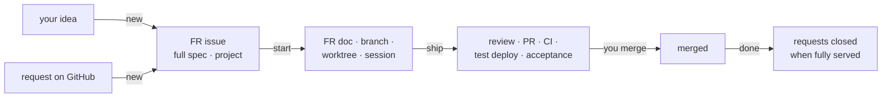

# claude-fr-workflow

A Claude Code plugin for a feature-request workflow in GitHub projects. It
carries one way of working from project to project, independent of what else a
developer has installed.



| Command                  | Does                                                                                                                                       |
| ------------------------ | ------------------------------------------------------------------------------------------------------------------------------------------ |
| `/fr-workflow:init`      | once per repository: project profile, FR folder, issue form, labels, team settings                                                         |
| `/fr-workflow:new`       | define: an idea or GitHub issues, worked out with the code into FR issues that hold the full spec — local first or GitHub first            |
| `/fr-workflow:start`     | build: pulls the FR issue, checks it against the current code, then branch, FR doc, worktree and a fresh session — several FRs in parallel |
| `/fr-workflow:implement` | in the worktree session: the FR doc is the brief — implements, commits locally, never pushes                                               |
| `/fr-workflow:ship`      | finish: code and security review → PR → CI → test deployment → acceptance check → result into the FR document                              |
| `/fr-workflow:done`      | after the merge — or to drop an FR: close fully served requests (asks first), clean up                                                     |
| `/fr-workflow:status`    | overview of all FRs with their sessions, the requests still to define, and which FRs can run in parallel                                   |

## Documentation

| Page                                                      | For                                                                             |
| --------------------------------------------------------- | ------------------------------------------------------------------------------- |
| [Installation](docs/installation.md)                      | setting up a repository, prerequisites for developers, updates, troubleshooting |
| [Usage](docs/usage.md)                                    | the workflow step by step, with an example                                      |
| [Profile reference](docs/profile.md)                      | every setting in `.claude/workflow.md`, choosing the deploy signal              |
| [For issue authors](docs/for-issue-authors.md)            | customers and others who write issues — no technical knowledge needed           |
| [Model and rules](plugins/fr-workflow/reference/model.md) | the data model and the hard rules every command follows                         |

## Design decisions

- **The issue is the spec until the start.** Defining needs the code, so it
  happens locally — but the result lives on GitHub, where it can be read,
  prioritized and planned. `start` only pulls it, checks it and writes it into
  the FR document, the source from then on.
- **What GitHub has, not own bookkeeping.** An FR's id is its issue number;
  requests and FRs are linked with sub-issues and mentions; `Closes` closes the
  FR issue, `Refs` links the requests. `done` closes a request when all its FRs
  are closed — never a request on the first merge. The project board is the one
  place the plugin writes state GitHub cannot derive: with `project_status` the
  commands set its status column at every start and stop.
- **No shared index file.** A table edited in every PR conflicts and drifts;
  `status` derives the overview.
- **`merged` is derived, not written** — nothing needs to be committed to a
  protected base branch after a merge.
- **Project facts live in the project** (`.claude/workflow.md`), the process lives
  here. The plugin contains nothing customer-specific.
- **No code leaves the machine unreviewed.** Implementation sessions commit
  without pushing; `ship` pushes after the code and security review. A secret
  found there always stops and is removed from the unpushed commits.
- **Playwright MCP stays on `@latest`** — deliberately: it is maintained by
  Microsoft, and an outdated pin would be one more thing to keep up. The trade-off
  is that a new Playwright release reaches every project at once.
- **No CI skip markers, anywhere.** A squash merge would carry them onto the base
  branch and skip its release. A build from the first push of an FR branch, which
  holds only the FR document, is avoided with `paths-ignore` on push triggers,
  which `init` proposes.
- **Hard limits:** never merges, never triggers deployments, never touches
  production, never handles credentials.

## Maintaining the plugin

**Layout**

```
.claude-plugin/marketplace.json     the marketplace (lists the plugin by relative path)
plugins/fr-workflow/
  .claude-plugin/plugin.json        name, version
  .mcp.json                         bundled Playwright MCP server
  skills/<command>/SKILL.md         one folder per command
  agents/                           reviewer agents for ship, adapted from pr-review-toolkit (Apache-2.0)
  reference/model.md                model and rules, read by every command
  scripts/fr.sh                     deterministic part: FR list, FR doc from the issue, FRs of a request, overlap, lock, board status
  templates/                        FR issue, profile, issue form, FR folder README
docs/                               user documentation
tests/fr-sh.sh                      regression suite for scripts/fr.sh
CLAUDE.md                           decisions, conventions and pitfalls for maintainers
```

**Develop and test**

- Load the working copy instead of a tag: `claude --plugin-dir plugins/fr-workflow`.
- `fr.sh` must keep running on bash 3.2 (macOS) and Git Bash: no associative
  arrays, no `mapfile`, no `case` inside `$(…)`. Check with
  `/bin/bash -n plugins/fr-workflow/scripts/fr.sh`.
- `bash tests/fr-sh.sh` runs the regression suite for `fr.sh` against throwaway
  repos with a stub `gh` — nothing reaches GitHub. On macOS run it with
  `/bin/bash` (3.2). Every bug fixed in `fr.sh` gets a case there.
- `claude plugin validate .` and `claude plugin validate plugins/fr-workflow`.
- End-to-end in the private sandbox `bmoers/fr-workflow-sandbox`: raise its pinned
  `ref` only after a change works there.

**Release**

1. `/bin/bash tests/fr-sh.sh` reports `0 failed`, and both `claude plugin validate`
   runs pass.
2. Add the version to [`CHANGELOG.md`](CHANGELOG.md).
3. Raise `version` in `plugins/fr-workflow/.claude-plugin/plugin.json`.
4. Update the example tag in `docs/installation.md`.
5. Commit, tag `vX.Y.Z`, push the tag. Never move a pushed tag — release a new one.

**Access while private:** every developer of a project using the plugin needs read
access to this repository. Background auto-update is off for this marketplace;
projects update by raising their pinned `ref`.
