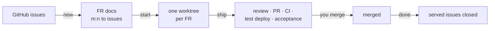

# claude-fr-workflow

A Claude Code plugin for a feature-request workflow in GitHub projects. It
carries one way of working from project to project, independent of what else a
developer has installed.



| Command | Does |
|---|---|
| `/fr-workflow:init` | once per repository: project profile, FR folder, team settings |
| `/fr-workflow:new` | plan: issues and/or a discussion → one or more FR documents, each on a pushed branch |
| `/fr-workflow:start` | build: a worktree per FR and a fresh session with the FR's model and effort — several non-overlapping FRs in parallel, as background sessions |
| `/fr-workflow:ship` | finish: code and security review → PR → CI → test deployment → acceptance check → result into the FR document |
| `/fr-workflow:done` | after the merge — or to drop an FR: close fully served issues (asks first), clean up |
| `/fr-workflow:status` | overview of all FRs with their sessions, and which can run in parallel |
| `/fr-workflow:sync` | refresh the generated issue comments, e.g. after editing an FR by hand |

## Documentation

| Page | For |
|---|---|
| [Installation](docs/installation.md) | setting up a repository, prerequisites for developers, updates, troubleshooting |
| [Usage](docs/usage.md) | the workflow step by step, with an example |
| [Profile reference](docs/profile.md) | every setting in `.claude/workflow.md`, choosing the deploy signal |
| [For issue authors](docs/for-issue-authors.md) | customers and others who write issues — no technical knowledge needed |
| [Model and rules](plugins/fr-workflow/reference/model.md) | the data model and the hard rules every command follows |

## Design decisions

- **The FR frontmatter is the single source of truth** for the m:n link. The
  comment on each issue is derived by `scripts/fr.sh` and can be regenerated at
  any time.
- **`Refs`, never `Closes`.** With m:n the first merge would close an issue other
  FRs still serve. `done` closes an issue when all its FRs are merged.
- **No shared index file.** A table edited in every PR conflicts and drifts;
  `status` derives the overview.
- **`merged` is derived, not written** — nothing needs to be committed to a
  protected base branch after a merge.
- **Project facts live in the project** (`.claude/workflow.md`), the process lives
  here. The plugin contains nothing customer-specific.
- **No code leaves the machine unreviewed.** Implementation sessions commit
  without pushing; `ship` pushes after the code and security review. A secret
  found there always stops and is removed from the unpushed commits.
- **Playwright MCP stays on `@latest`** — deliberately: it is maintained by
  Microsoft, and an outdated pin would be one more thing to keep up. The trade-off
  is that a new Playwright release reaches every project at once.
- **No CI skip markers, anywhere.** A squash merge would carry them onto the base
  branch and skip its release. Builds from planning pushes are avoided with
  `paths-ignore` on push triggers, which `init` proposes.
- **Hard limits:** never merges, never triggers deployments, never touches
  production, never handles credentials.

## Maintaining the plugin

**Layout**

```
.claude-plugin/marketplace.json     the marketplace (lists the plugin by relative path)
plugins/fr-workflow/
  .claude-plugin/plugin.json        name, version
  .mcp.json                         bundled Playwright MCP server
  skills/<command>/SKILL.md         one folder per command
  reference/model.md                model and rules, read by every command
  scripts/fr.sh                     deterministic part: FR list, ids, issue comments
  templates/                        FR document, profile, FR folder README
docs/                               user documentation
```

**Develop and test**

- Load the working copy instead of a tag: `claude --plugin-dir plugins/fr-workflow`.
- `fr.sh` must keep running on bash 3.2 (macOS) and Git Bash: no associative
  arrays, no `mapfile`. Check with `/bin/bash -n plugins/fr-workflow/scripts/fr.sh`.
- `claude plugin validate .` and `claude plugin validate plugins/fr-workflow`.
- End-to-end in the private sandbox `bmoers/fr-workflow-sandbox`: raise its pinned
  `ref` only after a change works there.

**Release**

1. Add the version to [`CHANGELOG.md`](CHANGELOG.md).
2. Raise `version` in `plugins/fr-workflow/.claude-plugin/plugin.json`.
3. Update the example tag in `docs/installation.md`.
4. Commit, tag `vX.Y.Z`, push the tag. Never move a pushed tag — release a new one.

**Access while private:** every developer of a project using the plugin needs read
access to this repository. Background auto-update is off for this marketplace;
projects update by raising their pinned `ref`.
