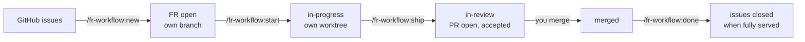

# Using fr-workflow

## The idea in one minute

- **Issues** say what was asked for — usually by the customer, in GitHub.
- **FRs** (feature requests) say what gets built: a Markdown document in the
  repository with a spec and acceptance criteria. **One FR = one branch = one PR.**
- Issues and FRs are linked **m:n**: one issue can need several FRs, one FR can
  serve several issues. The link is written in the FR document; every linked issue
  shows a generated comment listing its FRs.
- Work happens in **two sessions**: plan first, without code; then build, in a
  fresh session inside the FR's own worktree, where the FR document is the whole
  brief.
- Finishing an FR runs through **gates** — review, CI, test deployment,
  acceptance check. Any gate that fails stops and asks you. **A human merges.**



## The example used below

The customer opened **#12** "Coupons in checkout" and **#15** "Show the discount
on the invoice". Planning shows that coupons need a checkout change *and* an
invoice change, and that #15 is exactly that invoice change. Result:

| FR | Title | Serves |
|---|---|---|
| FR-012 | Coupon field in checkout | #12 |
| FR-013 | Discount line on invoice | #12, #15 |

## Step 1 — Plan: `/fr-workflow:new`

**When:** an issue, or a batch of issues, is ready to be worked on.

**Type:** `/fr-workflow:new #12 #15`. Instead of numbers you can pass
`label:checkout`, `milestone:"Q4"`, `project:acme/3` (a GitHub project),
`search:"invoice"` — or simply describe the feature, without any issue.

**What happens:**

1. Claude reads the issues with their comments, and checks whether FRs exist for
   them already.
2. It summarizes what was asked, names gaps and contradictions, and asks
   questions. It may read code to judge the scope — it changes nothing.
3. It proposes the cut as a table like the one above. You adjust it until it is
   right, then confirm.
4. For each FR it picks the next free id, creates a branch
   (`feat/fr-012-coupon-field-checkout`), writes the FR document, commits and
   pushes it. Your own checkout is not touched.
5. Every listed issue gets its comment with the FRs.

**Your job:** the acceptance criteria. Each one must be checkable on the test
environment by someone who did not write the code — they are what step 3
checks.

End the session here.

## Step 2 — Build: `/fr-workflow:start FR-012`

- Creates the worktree `.claude/worktrees/fr-012-coupon-field-checkout` on the
  FR's branch, sets the FR to `in-progress`, pushes, updates the issue comments.
- **Stops** if the FR document has no real acceptance criteria yet — that is
  planning work, back to step 1.
- Hands you the command for a fresh session in the worktree:

  ```bash
  cd .claude/worktrees/fr-012-coupon-field-checkout && claude "Implement FR-012 as specified in req/feature-requests/FR-012-coupon-field-checkout.md. Read it first."
  ```

While implementing, decisions and deviations go into the FR document, in the same
commits as the code. Several FRs at once? Each has its own worktree; run one Claude
session per worktree.

## Step 3 — Finish: `/fr-workflow:ship`

Run it in the FR's worktree. It works through seven steps; each one can stop.

| # | Step | Stops when |
|---|---|---|
| 1 | Code review of everything the branch changes (Claude Code's built-in `/code-review`), then the project's fast local checks | review findings, failing checks |
| 2 | Commit, push, open the PR — linking the issues with `Refs #12`, never `Closes` | — |
| 3 | Wait for CI | a check fails |
| 4 | Wait for the test deployment, the way the profile describes | the deployment fails or does not come in time — it never starts one itself |
| 5 | Acceptance check: every criterion becomes a concrete check, run in a browser against the test environment | a criterion fails; a login page appears (you log in yourself, in the browser window); criteria it could not verify (you decide) |
| 6 | Write the result into the FR document, set `in-review`, push, update the issue comments | — |
| 7 | Optionally tell the customer on the issues: "Ready for acceptance on …"; report | — |

**When it stops,** Claude shows what it found — findings, a failing log, a
screenshot. You decide: fix it and run `/fr-workflow:ship` again (it reuses the
PR), accept it, or stop.

**No test environment?** Then step 5 checks what it can locally — tests, a local
run, the code — and lists the criteria it could not verify. They count only if
you accept them, and the FR document says so.

## Step 4 — Merge: you

Review the PR as usual; the FR document is part of it and shows what was
accepted. Merge it — squash is fine. The plugin never merges.

## Step 5 — Close: `/fr-workflow:done FR-012`

Run it in the main checkout, not in the worktree.

- Checks that the PR is merged and updates the issue comments.
- For each linked issue it checks whether **all** its FRs are merged. Only then
  does it propose closing the issue — and closes it after you confirm.
- Removes the worktree and the local branch. After a squash merge git cannot see
  that the branch was merged; then it asks before deleting.

In the example: after FR-012 is merged, #12 stays open — FR-013 is not merged yet.
After FR-013 is merged, both #12 and #15 can be closed.

## Any time: `/fr-workflow:status`

An overview of all FRs — including those that exist only on their branch — with
status, issues and PR. `/fr-workflow:status #12` shows the FRs of one issue,
`/fr-workflow:status FR-013` one FR with its PR checks. It also points out
inconsistencies, such as an FR in review without a PR.

## What an issue shows

Every linked issue carries one comment, maintained by the plugin:

> **Feature requests for this issue**
>
> | FR | Title | Status | PR |
> |---|---|---|---|
> | FR-012 | Coupon field in checkout | merged | acme/shop#87 |
> | FR-013 | Discount line on invoice | in-review | acme/shop#91 |

It is generated from the FR documents and rewritten on every change — manual
edits are lost.

## Statuses

| Status | Meaning | Set by |
|---|---|---|
| `open` | planned and specified, not started | `/fr-workflow:new` |
| `in-progress` | being implemented | `/fr-workflow:start` |
| `in-review` | PR open, acceptance check passed | `/fr-workflow:ship` |
| `merged` | PR merged — derived, never written: an FR in review that has reached the base branch | — |
| `dropped` | abandoned | you, in the FR document |

## What the plugin never does

- merge a PR;
- start or re-run a deployment;
- touch production — unless you ask for one specific action;
- force-push, or discard your uncommitted changes;
- ask for, store or type passwords — at a login page you log in yourself;
- close an issue without asking;
- put personal or customer data into commits, PRs, issue comments or screenshots.

The project profile and the project's `CLAUDE.md` can add rules; they never
relax these.

## Questions

**Can I work without issues?** Yes. Describe the feature to `/fr-workflow:new`;
the FR then has no linked issue.

**Can I change which issues an FR serves?** Edit the `issues:` line in the FR
document on its branch and push. See the limitations below for the issue comments.

**Can several developers plan at the same time?** Yes. Ids are taken from all
branches, and `/fr-workflow:new` pushes each FR right away so others see it.

**Can I edit an FR document by hand?** Yes, it is Markdown. Keep the frontmatter
at the top as it is: one `key: value` per line, the issue list on one line.

**What does the customer see?** The issue comments: the generated FR list and, if
the project turned it on, the "ready for acceptance" note. The FR documents are in
the repository.

## Known limitations (v0.1)

- GitHub and GitHub Actions only. Jira links are reserved in the format
  (`jira:KEY-123`) but not processed yet.
- Dropping an FR is manual: set `status: dropped` in its document and push. Its
  issues' comments update the next time a command touches them.
- When you remove an issue from an FR's `issues:` line, that issue's comment keeps
  the old entry until it is refreshed.
