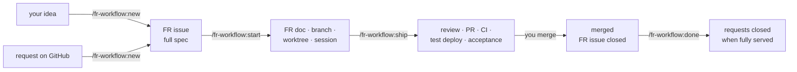

# Using fr-workflow

## The idea in one minute

- **Requests** say what was asked for — usually by the customer, as a GitHub
  issue. They may be rough.
- **FRs** (feature requests) say what gets built. An FR is a GitHub issue too,
  holding the full spec: acceptance criteria, failure behaviour, technical notes,
  the areas of code it changes. **One FR = one issue = one branch = one PR.**
- **Defining an FR needs the code**, so it happens locally with Claude — whether
  the idea starts in your head or as a request on GitHub. The result goes to
  GitHub: the FR issue holds everything, ideally in your GitHub project.
- **Starting an FR only pulls its issue,** checks it against the current code and
  writes it into an FR document on the FR's branch. From then on that document is
  the source, and a fresh Claude session builds from it.
- Finishing an FR runs through **gates** — review, CI, test deployment,
  acceptance check. Any gate that fails stops and asks you. **A human merges.**



## The example used below

The customer opened **#12** "Coupons in checkout" and **#15** "Show the discount
on the invoice". Working them out shows that coupons need a checkout change *and*
an invoice change, and that #15 is exactly that invoice change. Result:

| FR    | Title                    | On GitHub            | Serves   |
| ----- | ------------------------ | -------------------- | -------- |
| FR-20 | Coupon field in checkout | sub-issue #20 of #12 | #12      |
| FR-21 | Discount line on invoice | sub-issue #21 of #12 | #12, #15 |

## Step 1 — Define: `/fr-workflow:new`

Two ways in, one result: FR issues that hold the complete spec.

- **Local first — you have an idea.** `/fr-workflow:new coupons in checkout`, or
  just `/fr-workflow:new` and describe it. Claude works it out with you and
  creates the FR issue.
- **GitHub first — someone filed a request.** On GitHub, *New issue → Feature
  request*: the repository's issue form (set up by `/fr-workflow:init`, label
  `fr-request`) asks for problem, who is affected, desired behaviour, **how we
  know it is done**, priority and **size** — rough is fine. This is the way for
  customers and anyone without Claude Code, see
  [for issue authors](for-issue-authors.md). Then `/fr-workflow:new #12 #15`
  works it out. Instead of numbers you can pass `label:checkout`,
  `milestone:"Q4"`, `project:acme/3` (a GitHub project), `search:"invoice"`, or a
  local file such as `docs/notes/coupons.md`.

**What happens:**

1. Claude reads the requests with their comments and checks whether FRs serve
   them already. Fields of the issue form are taken over — the *How do we know
   it is done* sentences become acceptance criteria, the size gives model and
   effort.
2. It reads the code as it is on `origin/main`, summarizes what was asked, names
   gaps and contradictions, and asks — including what should happen when
   something fails (*Failure behaviour*) and, for new data types, what must
   always hold. It changes nothing in the repository.
3. It proposes the cut as a table like the one above: which request becomes
   which FR, with the areas of code each one changes and the model and effort
   for building it. You adjust it until it is right, then confirm.
4. It writes the FR issues on GitHub:
   - a request that is exactly one change **becomes the FR** — its description
     is replaced by the spec, the original text kept at its end;
   - a request that needs several changes gets one **sub-issue** per FR;
   - an FR serving several requests is a sub-issue of one and lists the others
     under *Requests*;
   - an idea becomes a new issue.

   Each gets the label `fr` and, if the profile names one, goes into your
   **GitHub project**. Authors of rewritten or split requests get a short note.
5. It tells you which FRs can be built in parallel.

**Your job:** the acceptance criteria. Each one must be checkable on the test
environment by someone who did not write the code — they are what step 3
checks.

**Refining.** Until an FR is started its issue is the spec: run
`/fr-workflow:new #20` again, or edit the issue on GitHub — keep the headings and
the *Planning* lines as they are. Prioritize and schedule the FR issues in your
GitHub project as you like.

**Size, model, effort.** Whoever files a request estimates its size (`S`, `M`,
`L`, `XL` or "don't know"); the profile's `size_models` turns that into model and
effort for the implementation, e.g. `S → sonnet / low`, `L → opus / high`.
Technical teams can set model and effort directly in the request; that wins over
the size and is **binding** — `new` never changes it. A value from the size is an
estimate: `new` may propose a different one per FR — one small FR cut from an `L`
request does not need the large setting — shows the reason in its table, and you
decide.

End the session here.

## Step 2 — Build: `/fr-workflow:start #20`

- Pulls the FR issue and checks it is ready: open, label `fr`, acceptance
  criteria, no open questions. If not, it says what is missing — back to step 1.
- Checks whether the code in the FR's areas changed since it was defined (the
  issue records the commit it was read at). If so, it shows what changed, and you
  decide: start anyway, or refine first.
- Creates the branch `feat/fr-20-coupon-field-checkout` from the latest
  `origin/main` with the **FR document** as its first commit, pushes it, and
  prepares the worktree `.claude/worktrees/fr-20-coupon-field-checkout`. It never
  commits to the branch you are on, nor to `main`.
- Hands you the command for a fresh session in the worktree, with the model and
  effort chosen for this FR:

  ```bash
  claude -w fr-20-coupon-field-checkout --model opus --effort high -n 'FR-20 Coupon field in checkout' 'Implement FR-20. …'
  ```

  `-w` opens the worktree that `start` just prepared, on the FR's branch. As a
  safety net the session first checks that it is on that branch and stops if not.

From here the FR document is the source: decisions and deviations go into it, in
the same commits as the code — the issue keeps the spec as it was. The session
**commits but does not push** — code leaves your machine only through
`/fr-workflow:ship`, after its review. The session ends with a summary; you then
run `/fr-workflow:ship` in it.

**Several FRs:** `/fr-workflow:start #20 #22 #23` — see
[working in parallel](#working-in-parallel).

## Step 3 — Finish: `/fr-workflow:ship`

Run it in the FR's worktree. It works through seven steps; each one can stop.

| #   | Step                                                                                                                                                                                                                                                                                                                                                 | Stops when                                                                                                                      |
| --- | ---------------------------------------------------------------------------------------------------------------------------------------------------------------------------------------------------------------------------------------------------------------------------------------------------------------------------------------------------- | ------------------------------------------------------------------------------------------------------------------------------- |
| 1   | Commits locally, then reviews everything the branch changes against `main` — Claude Code's built-in `/code-review` and `/security-review`, and the plugin's review of error handling (`review_agents`), side by side — then the project's fast local checks. **A secret always stops**, cannot be accepted, and is removed before anything is pushed | review or security findings, failing checks                                                                                     |
| 2   | The first push of the code, then the PR — `Closes #20` for the FR's issue, `Refs #12` for the requests it serves. If another FR was merged meanwhile and the PR conflicts, it merges `main` into the branch (no rebase, no force push) and reviews again                                                                                             | conflicts that need a decision                                                                                                  |
| 3   | Wait for CI                                                                                                                                                                                                                                                                                                                                          | a check fails                                                                                                                   |
| 4   | Wait for the test deployment, the way the profile describes                                                                                                                                                                                                                                                                                          | the deployment fails or does not come in time — it never starts one itself                                                      |
| 5   | Acceptance check: every criterion becomes a concrete check, run in a browser against the test environment                                                                                                                                                                                                                                            | a criterion fails; a login page appears (you log in yourself, in the browser window); criteria it could not verify (you decide) |
| 6   | Write the result into the FR document, set `in-review`, push                                                                                                                                                                                                                                                                                         | —                                                                                                                               |
| 7   | Optionally tell the customer on the FR issue and its requests: "Ready for acceptance on …"; report                                                                                                                                                                                                                                                   | —                                                                                                                               |

**When it stops,** Claude shows what it found — findings, a failing log, a
screenshot. You decide: fix it and run `/fr-workflow:ship` again (it reuses the
PR), accept it, or stop. A security finding you accept is listed with your reason
in the PR under *Review notes*, so whoever reviews the PR sees it.

**No test environment?** Then step 5 checks what it can locally — tests, a local
run, the code — and lists the criteria it could not verify. They count only if
you accept them, and the FR document says so.

## Step 4 — Merge: you

Review the PR as usual; the FR document is part of it and shows what was
accepted. Merge it — squash is fine. The plugin never merges. GitHub closes the
FR's issue with the merge (`Closes #20`).

## Step 5 — Close: `/fr-workflow:done #20`

Run it in the main checkout, not in the worktree.

- Checks that the PR is merged, and closes the FR issue if the merge did not —
  closing keywords only work for PRs into the repository's default branch.
- For each request the FR serves it checks whether **all** its FRs are closed.
  Only then does it propose closing the request — and closes it after you
  confirm.
- Removes the worktree and the local branch. After a squash merge git cannot see
  that the branch was merged; then it asks before deleting.

In the example: after FR-20 is merged, #12 stays open — FR-21 is not merged yet.
After FR-21 is merged, both #12 and #15 can be closed.

**Dropping an FR instead:** `/fr-workflow:done #21 drop`. It asks for the reason,
marks the FR document `dropped` on its branch (if it was started), proposes
closing the FR issue as *not planned*, and cleans up locally. The branch stays on
GitHub as the record. A request whose FRs were all dropped is not closed as done:
Claude proposes defining it again or closing it as "not planned" — your call.

## Any time: `/fr-workflow:status`

An overview of all FRs — defined but not started, in progress on their branch, in
review — with their requests, PR and the Claude session working on each. It
lists the requests still waiting for `/fr-workflow:new`, and which FRs could start
now. `/fr-workflow:status #12` shows the FRs of one request,
`/fr-workflow:status #21` one FR with its PR checks. It points out inconsistencies
too, such as an FR in review without a PR.

## Working in parallel

FRs that do not touch the same code can be built at the same time, each in its
own worktree with its own Claude session.

**Which FRs fit together.** Every FR names its *Areas* — the folders or files it
will change. Once work has started, the files its branch actually changed count
as well. Two FRs overlap when one path lies inside the other, or when both touch
the same *shared path* from the profile (a migrations folder, a lockfile,
translation files). An FR without any of this overlaps everything: the plugin
only claims "parallel" when it can show it. `/fr-workflow:new` and
`/fr-workflow:status` show the result as waves:

> wave 1: FR-20, FR-22, FR-23 — can run together
> wave 2: FR-21 — overlaps FR-20 in `src/checkout`

**Starting them.** `/fr-workflow:start #20 #22 #23` prepares all three and starts
one Claude session per FR **in the background**, each with its FR's model and
effort. FRs of later waves are not started; it says why.

**Following them.**

| To                                    | Run                                                                                  |
| ------------------------------------- | ------------------------------------------------------------------------------------ |
| see all sessions and their state live | `claude agents`                                                                      |
| read what one is doing                | `claude logs "FR-20"` (the raw terminal capture — `claude attach` is easier to read) |
| answer its questions, or take over    | `claude attach "FR-20"`                                                              |
| see FRs and sessions side by side     | `/fr-workflow:status`                                                                |

A background session that needs a permission waits — `claude agents` shows it;
attach to answer. When a session is done, attach and run `/fr-workflow:ship`.

**Shipping in parallel.** PRs reach `main` one after another, so a later PR may
conflict; `ship` then merges `main` into its branch, or stops if a conflict needs a
decision. Whether acceptance checks can run in parallel depends on the test
environment:

| `test_env` in the profile                | Acceptance checks                                                                                                                                                                                           |
| ---------------------------------------- | ----------------------------------------------------------------------------------------------------------------------------------------------------------------------------------------------------------- |
| `per-pr` — every PR gets its own preview | in parallel                                                                                                                                                                                                 |
| `shared` — one deployment at a time      | one after the other: a lock lets one FR at a time from its deploying push to its recorded result; the others wait. With `deploy_signal: url` the deployed commit is also checked before and after the check |

The lock covers the sessions on your machine. Other developers deploying to the
same shared environment are caught by the commit check — another reason to
prefer a version URL.

**Cost.** Every parallel session uses your Claude plan at the same time. Small FRs
get a smaller model or effort when they are defined; change *Model* and *Effort*
in the issue's *Planning* before starting.

## What GitHub shows

- **A request** lists its FRs as sub-issues, with a progress bar; an FR that
  serves it without being its sub-issue appears in its timeline.
- **An FR issue** is the spec as it was defined. Its *Development* box links the
  PR once `ship` opened it; the merge closes it.
- **Your GitHub project**, if the profile names one, has every FR issue. By
  default GitHub's built-in project workflows move the cards — *Item closed* →
  Done is on by default; *Auto-add to project* with the filter `label:fr`
  catches FR issues written by hand too. If the profile maps the plugin's events
  to the board's status column (`project_status`), the commands set it
  themselves: *defined* when the FR is ready, *running* from the start, *input*,
  *blocked* or *failed* when a command stops and says why, *approval* when the
  PR waits for your merge, *done* after `done` — under the names your board
  uses. A board that cannot be written is a line in the report, never a stop.

## Planning on the board

The board shows, it does not drive. The commands write the status column at
their events and never read it; what runs is decided by the issues (label
`fr`, their *Planning*) and by the command you type. In practice:

- **Intake.** Requests arrive through the issue form (label `fr-request`): a
  wish, not checked against the code, not startable. An FR issue (label `fr`)
  is the worked-out spec, one PR each; only those can start. To see both on
  the board, give it a column for wishes — *Backlog* — with the *Auto-add*
  filter `is:issue label:fr,fr-request` and *Item added to project* → *Backlog*:
  requests stay there until `new` works them out, FR issues leave it at once
  because `new` writes *Ready* right after creating them.
- **Definition.** `/fr-workflow:new #<request>` or `/fr-workflow:new <idea>`
  turns them into FR issues: cards in *Ready*, or in *Waiting for Input* when a
  question was left open. Answer on the issue, then `/fr-workflow:new #<n>`
  again.
- **Prioritising.** Order, group, filter, add your own fields (Priority,
  Iteration, Estimate) — the plugin ignores them, nothing breaks. *Size*,
  *Model* and *Effort* of an FR live in its *Planning*; edit them in the issue
  before starting.
- **Starting.** Pick the cards and type `/fr-workflow:start #47 #48`; the
  command tells you which of them can run side by side. Dragging a card to
  *Running* starts nothing.
- **Following.** *Running*, *Failed*, *Blocked*, *Waiting for Input* and
  *Waiting for Approval* are written by `start` and `ship` as they go; the why
  is in the command's report, not on the card. *Waiting for Approval* means:
  merge the PR, then `/fr-workflow:done`.
- **Closing.** `done` writes *Complete* for merged and dropped FRs; an issue
  closed by hand gets there through the *Item closed* workflow.
- **Setting it up.** `/fr-workflow:init` proposes the mapping;
  `fr.sh project-options` adds the values the column lacks; the workflows
  (*Item added* → your `defined` value, *Item closed* → your `done` value,
  *Auto-add* with `is:issue label:fr`) are set on the project's *Workflows*
  page — see [the profile](profile.md#board-status).

## Statuses

| Status        | Meaning                                                                              | Set by                        |
| ------------- | ------------------------------------------------------------------------------------ | ----------------------------- |
| `open`        | defined: an open FR issue, not started                                               | `/fr-workflow:new`            |
| `in-progress` | being implemented — the FR document exists on its branch                             | `/fr-workflow:start`          |
| `in-review`   | PR open, acceptance check passed                                                     | `/fr-workflow:ship`           |
| `merged`      | PR merged — derived, never written: an FR in review that has reached the base branch | —                             |
| `dropped`     | abandoned                                                                            | `/fr-workflow:done <ID> drop` |

## Which pushes trigger builds

`/fr-workflow:new` pushes nothing. `/fr-workflow:start` pushes a new branch whose
only commit is the FR document; implementation sessions push nothing. Whether that
first push starts a build depends on the project's workflows:

| Workflows trigger on   | The first push of an FR branch builds?         |
| ---------------------- | ---------------------------------------------- |
| `pull_request` only    | no — there is no PR yet                        |
| `push` to `main` only  | no                                             |
| `push` to every branch | yes, unless the workflow ignores the FR folder |

For the last case `/fr-workflow:init` proposes `paths-ignore` for the FR folder on
the `push` trigger — a change to your CI, so it only proposes it.

The plugin never uses `[skip ci]` or similar markers: a squash merge copies the
branch's commit messages into the commit on `main`, and the marker would then
skip `main`'s release and deployment.

`/fr-workflow:ship`'s last commit, with the acceptance result, does build again.
That is intended — the commit that gets merged must have green checks.

## What the plugin never does

- merge a PR;
- start or re-run a deployment;
- touch production — unless you ask for one specific action;
- push code that has not been through the code and security review;
- force-push, or discard your uncommitted changes;
- write CI skip markers such as `[skip ci]` anywhere;
- ask for, store or type passwords — at a login page you log in yourself;
- close a request without asking;
- put personal or customer data into commits, PRs, issues, issue comments or
  screenshots.

The project profile and the project's `CLAUDE.md` can add rules; they never
relax these.

## Questions

**Can I work without a request?** Yes — that is the local-first way. Describe the
feature to `/fr-workflow:new`; it creates the FR issue. The FR then serves no
request.

**Can I change which requests an FR serves?** Before the start: the *Requests*
line in the FR issue's *Planning*, or its parent on GitHub. After the start: the
`requests:` line in the FR document.

**Can I start from notes or an old FR document?** Yes: `/fr-workflow:new <file>`.
The file is read, not changed.

**Can I rename a worktree?** No need, and better not: `start` names it after the
FR so that `claude -w` reopens it and `status` can match its session. A running
session also locks its worktree.

**Can several developers define FRs at the same time?** Yes. An FR's id is its
issue number, so ids never clash.

**Can I edit an FR by hand?** Yes. Before the start, the issue on GitHub — keep
its headings and the *Planning* lines. After the start, the FR document: keep the
frontmatter at the top as it is, one `key: value` per line, lists on one line.

**What does the customer see?** The issues: the FR spec in each FR issue, the
short notes of `/fr-workflow:new`, and, if the project turned it on, the "ready
for acceptance" note. FR issues live in the same repository as the requests
(`issue_repo`), so whoever reads the requests reads the specs.

## Known limitations

- GitHub and GitHub Actions only. Jira is not supported.
- Requests and FR issues live in one repository (`issue_repo`).
- The headings of an FR issue and its *Planning* keys must stay in English.
  Everything else the commands write to GitHub — issue text, comments, PR
  descriptions — follows the language of its source: the idea, the file, the
  request. The generated preamble of the FR doc stays English.
