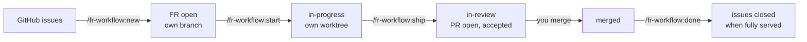

# Using fr-workflow

## The idea in one minute

- **Issues** say what was asked for — usually by the customer, in GitHub.
- **FRs** (feature requests) say what gets built: a Markdown document in the
  repository with a spec and acceptance criteria. **One FR = one branch = one PR.**
- Issues and FRs are linked **m:n**: one issue can need several FRs, one FR can
  serve several issues. The link is written in the FR document; every linked issue
  shows a generated comment listing its FRs.
- Work happens in **two sessions**: plan first, without code; then build, in a
  fresh session inside the FR's own worktree, where the FR document is the whole
  brief.
- Finishing an FR runs through **gates** — review, CI, test deployment,
  acceptance check. Any gate that fails stops and asks you. **A human merges.**



## The example used below

The customer opened **#12** "Coupons in checkout" and **#15** "Show the discount
on the invoice". Planning shows that coupons need a checkout change *and* an
invoice change, and that #15 is exactly that invoice change. Result:

| FR | Title | Serves |
|---|---|---|
| FR-012 | Coupon field in checkout | #12 |
| FR-013 | Discount line on invoice | #12, #15 |

## Step 0 — Define the issue

Every piece of work starts as an issue in one standard shape — the repository's
issue form (`.github/ISSUE_TEMPLATE/feature-request.yml`, set up by
`/fr-workflow:init`): problem, who is affected, desired behaviour, **how we know it
is done**, priority, **size**, and optionally model and effort. There are two ways
in, and both produce the same issue:

- **On GitHub:** *New issue → Feature request*. This is the way for customers and
  anyone without Claude Code — see [for issue authors](for-issue-authors.md).
- **In a conversation:** `/fr-workflow:idea <the idea in a few words>`. Claude talks
  it through with you along the form's fields, asks until everything is clear,
  proposes a size, creates the issue after you confirm it — and goes straight on
  to planning (step 1) in the same session.

**Size, model, effort.** Whoever files the issue estimates its size (`S`, `M`, `L`,
`XL` or "don't know"); the profile's `size_models` turns that into model and
effort for the implementation, e.g. `S → sonnet / low`, `L → opus / high`.
Technical teams can set model and effort directly in the issue; that wins over
the size and is **binding** — planning never changes it. A value from the size is
an estimate: planning may propose a different one per FR — one small FR cut from
an `L` issue does not need the large setting — shows the reason in its table, and
you decide.

## Step 1 — Plan: `/fr-workflow:new`

**When:** an issue, or a batch of issues, is ready to be worked on.

**Type:** `/fr-workflow:new #12 #15`. Instead of numbers you can pass
`label:checkout`, `milestone:"Q4"`, `project:acme/3` (a GitHub project),
`search:"invoice"`, a local file such as `docs/notes/coupons.md` — or simply
describe the feature, without any issue.

**What happens:**

1. Claude reads the issues with their comments, and checks whether FRs exist for
   them already. Issues from the form are taken over field by field — the *How do
   we know it is done* sentences become the acceptance criteria, the size gives
   model and effort. Free-form issues work too; the discussion then fills the
   gaps.
2. It summarizes what was asked, names gaps and contradictions, and asks
   questions. It may read code to judge the scope — it changes nothing.
3. It proposes the cut as a table like the one above. You adjust it until it is
   right, then confirm.
4. For each FR it picks the next free id and creates a **new branch**
   (`feat/fr-012-coupon-field-checkout`) from the latest `origin/main`, in a
   temporary worktree. There it writes the FR document, commits and pushes. It
   never commits to the branch you are on, nor to `main` — which branch you are on
   and what you have uncommitted does not matter.
5. Every listed issue gets its comment with the FRs.
6. It tells you which of the new FRs can be built in parallel.

**Your job:** the acceptance criteria. Each one must be checkable on the test
environment by someone who did not write the code — they are what step 3
checks.

End the session here.

## Step 2 — Build: `/fr-workflow:start FR-012`

- Creates the worktree `.claude/worktrees/fr-012-coupon-field-checkout` on the
  FR's branch, sets the FR to `in-progress`, pushes, updates the issue comments.
- **Stops** if the FR document has no real acceptance criteria yet — that is
  planning work, back to step 1.
- Hands you the command for a fresh session in the worktree, with the model and
  effort chosen for this FR:

  ```bash
  claude -w fr-012-coupon-field-checkout --model opus --effort high -n "FR-012 Coupon field in checkout" 'Implement FR-012. …'
  ```

  `-w` opens the worktree that `start` just prepared, on the FR's branch. As a
  safety net the session first checks that it is on that branch and stops if not.

While implementing, decisions and deviations go into the FR document, in the same
commits as the code. The session **commits but does not push** — code leaves your
machine only through `/fr-workflow:ship`, after its review. The session ends with
a summary; you then run `/fr-workflow:ship` in it.

**Several FRs:** `/fr-workflow:start FR-012 FR-014 FR-015` — see
[working in parallel](#working-in-parallel).

## Step 3 — Finish: `/fr-workflow:ship`

Run it in the FR's worktree. It works through seven steps; each one can stop.

| # | Step | Stops when |
|---|---|---|
| 1 | Commits locally, then reviews everything the branch changes against `main` — Claude Code's built-in `/code-review` and `/security-review`, side by side — then the project's fast local checks. **A secret always stops**, cannot be accepted, and is removed before anything is pushed | review or security findings, failing checks |
| 2 | The first push of the code, then the PR — linking the issues with `Refs #12`, never `Closes`. If another FR was merged meanwhile and the PR conflicts, it merges `main` into the branch (no rebase, no force push) and reviews again | conflicts that need a decision |
| 3 | Wait for CI | a check fails |
| 4 | Wait for the test deployment, the way the profile describes | the deployment fails or does not come in time — it never starts one itself |
| 5 | Acceptance check: every criterion becomes a concrete check, run in a browser against the test environment | a criterion fails; a login page appears (you log in yourself, in the browser window); criteria it could not verify (you decide) |
| 6 | Write the result into the FR document, set `in-review`, push, update the issue comments | — |
| 7 | Optionally tell the customer on the issues: "Ready for acceptance on …"; report | — |

**When it stops,** Claude shows what it found — findings, a failing log, a
screenshot. You decide: fix it and run `/fr-workflow:ship` again (it reuses the
PR), accept it, or stop. A security finding you accept is listed with your reason
in the PR under *Review notes*, so whoever reviews the PR sees it.

**No test environment?** Then step 5 checks what it can locally — tests, a local
run, the code — and lists the criteria it could not verify. They count only if
you accept them, and the FR document says so.

## Step 4 — Merge: you

Review the PR as usual; the FR document is part of it and shows what was
accepted. Merge it — squash is fine. The plugin never merges.

## Step 5 — Close: `/fr-workflow:done FR-012`

Run it in the main checkout, not in the worktree.

- Checks that the PR is merged and updates the issue comments.
- For each linked issue it checks whether **all** its FRs are merged. Only then
  does it propose closing the issue — and closes it after you confirm.
- Removes the worktree and the local branch. After a squash merge git cannot see
  that the branch was merged; then it asks before deleting.

In the example: after FR-012 is merged, #12 stays open — FR-013 is not merged yet.
After FR-013 is merged, both #12 and #15 can be closed.

**Dropping an FR instead:** `/fr-workflow:done FR-013 drop`. It asks for the reason,
marks the FR `dropped` on its branch, updates the issue comments and cleans up
locally. The branch stays on GitHub as the record. An issue whose FRs were all
dropped is not closed as done: Claude proposes planning it again or closing it as
"not planned" — your call.

## Refreshing the issue comments: `/fr-workflow:sync`

The commands keep the comments current on their own. After you changed an FR
document by hand — for example its `issues:` line — run
`/fr-workflow:sync FR-013`. It also updates issues the FR *no longer* lists, so
their comment loses the entry. `/fr-workflow:sync #12` refreshes one issue,
`/fr-workflow:sync all` everything.

## Any time: `/fr-workflow:status`

An overview of all FRs — including those that exist only on their branch — with
status, issues, PR and the Claude session working on it. It also says which open
FRs could start now. `/fr-workflow:status #12` shows the FRs of one issue,
`/fr-workflow:status FR-013` one FR with its PR checks. It points out
inconsistencies too, such as an FR in review without a PR.

## Working in parallel

FRs that do not touch the same code can be built at the same time, each in its
own worktree with its own Claude session.

**Which FRs fit together.** At planning time every FR records its `areas` — the
folders or files it will change. Once work has started, the files its branch
actually changed count as well. Two FRs overlap when one path lies inside the
other, or when both touch the same *shared path* from the profile (a migrations
folder, a lockfile, translation files). An FR without any of this overlaps
everything: the plugin only claims "parallel" when it can show it.
`/fr-workflow:new` and `/fr-workflow:status` show the result as waves:

> wave 1: FR-012, FR-014, FR-015 — can run together
> wave 2: FR-013 — overlaps FR-012 in `src/invoice`

**Starting them.** `/fr-workflow:start FR-012 FR-014 FR-015` prepares all three and
starts one Claude session per FR **in the background**, each with its FR's model
and effort. FRs of later waves are not started; it says why.

**Following them.**

| To | Run |
|---|---|
| see all sessions and their state live | `claude agents` |
| read what one is doing | `claude logs "FR-012"` (the raw terminal capture — `claude attach` is easier to read) |
| answer its questions, or take over | `claude attach "FR-012"` |
| see FRs and sessions side by side | `/fr-workflow:status` |

A background session that needs a permission waits — `claude agents` shows it;
attach to answer. When a session is done, attach and run `/fr-workflow:ship`.

**Shipping in parallel.** PRs reach `main` one after another, so a later PR may
conflict; `ship` then merges `main` into its branch, or stops if a conflict needs a
decision. Whether acceptance checks can run in parallel depends on the test
environment:

| `test_env` in the profile | Acceptance checks |
|---|---|
| `per-pr` — every PR gets its own preview | in parallel |
| `shared` — one deployment at a time | one after the other: a lock lets one FR at a time from its deploying push to its recorded result; the others wait. With `deploy_signal: url` the deployed commit is also checked before and after the check |

The lock covers the sessions on your machine. Other developers deploying to the
same shared environment are caught by the commit check — another reason to
prefer a version URL.

**Cost.** Every parallel session uses your Claude plan at the same time. Small FRs
get a smaller model or effort at planning time; you can change it in the FR's
frontmatter (`model:`, `effort:`) before starting.

## What an issue shows

Every linked issue carries one comment, maintained by the plugin:

> **Feature requests for this issue**
>
> | FR | Title | Status | PR |
> |---|---|---|---|
> | FR-012 | Coupon field in checkout | merged | acme/shop#87 |
> | FR-013 | Discount line on invoice | in-review | acme/shop#91 |

It is generated from the FR documents and rewritten on every change — manual
edits are lost.

## Statuses

| Status | Meaning | Set by |
|---|---|---|
| `open` | planned and specified, not started | `/fr-workflow:new` |
| `in-progress` | being implemented | `/fr-workflow:start` |
| `in-review` | PR open, acceptance check passed | `/fr-workflow:ship` |
| `merged` | PR merged — derived, never written: an FR in review that has reached the base branch | — |
| `dropped` | abandoned | `/fr-workflow:done <ID> drop` |

## Which pushes trigger builds

`/fr-workflow:new` and `/fr-workflow:start` push commits that change only the FR
document; implementation sessions push nothing. Whether a planning push starts a
build depends on the project's workflows:

| Workflows trigger on | Planning pushes build? |
|---|---|
| `pull_request` only | no — there is no PR yet |
| `push` to `main` only | no |
| `push` to every branch | yes, unless the workflow ignores the FR folder |

For the last case `/fr-workflow:init` proposes `paths-ignore` for the FR folder on
the `push` trigger — a change to your CI, so it only proposes it.

The plugin never uses `[skip ci]` or similar markers: a squash merge copies the
branch's commit messages into the commit on `main`, and the marker would then
skip `main`'s release and deployment.

`/fr-workflow:ship`'s last commit, with the acceptance result, does build again.
That is intended — the commit that gets merged must have green checks.

## What the plugin never does

- merge a PR;
- start or re-run a deployment;
- touch production — unless you ask for one specific action;
- push code that has not been through the code and security review;
- force-push, or discard your uncommitted changes;
- write CI skip markers such as `[skip ci]` anywhere;
- ask for, store or type passwords — at a login page you log in yourself;
- close an issue without asking;
- put personal or customer data into commits, PRs, issue comments or screenshots.

The project profile and the project's `CLAUDE.md` can add rules; they never
relax these.

## Questions

**Can I work without issues?** Yes. Describe the feature to `/fr-workflow:new`;
the FR then has no linked issue.

**Can I change which issues an FR serves?** Edit the `issues:` line in the FR
document on its branch, push, then `/fr-workflow:sync <FR id>`.

**Can I start from notes or an old FR document?** Yes: `/fr-workflow:new <file>`.
The file is read, not changed; the new FR gets a new id and names the file as its
source.

**Can I rename a worktree?** No need, and better not: `start` names it after the
FR so that `claude -w` reopens it and `status` can match its session. A running
session also locks its worktree.

**Can several developers plan at the same time?** Yes. Ids are taken from all
branches, and `/fr-workflow:new` pushes each FR right away so others see it.

**Can I edit an FR document by hand?** Yes, it is Markdown. Keep the frontmatter
at the top as it is: one `key: value` per line, the issue list on one line.

**What does the customer see?** The issue comments: the generated FR list and, if
the project turned it on, the "ready for acceptance" note. The FR documents are in
the repository.

## Known limitations

- GitHub and GitHub Actions only. Jira links are reserved in the format
  (`jira:KEY-123`) but not processed yet.
- An existing FR document cannot be adopted with its id; `/fr-workflow:new <file>`
  creates a new FR from it.
